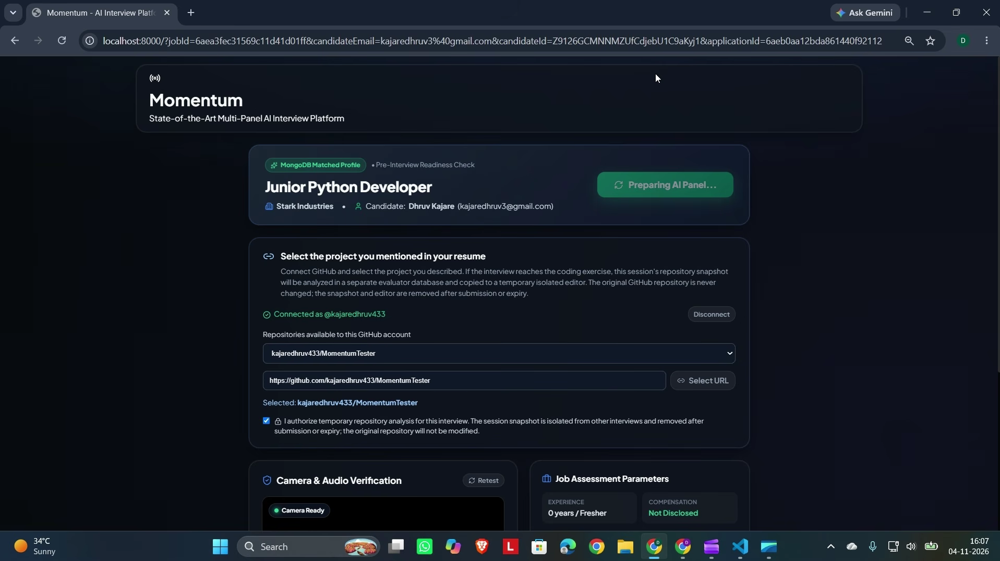
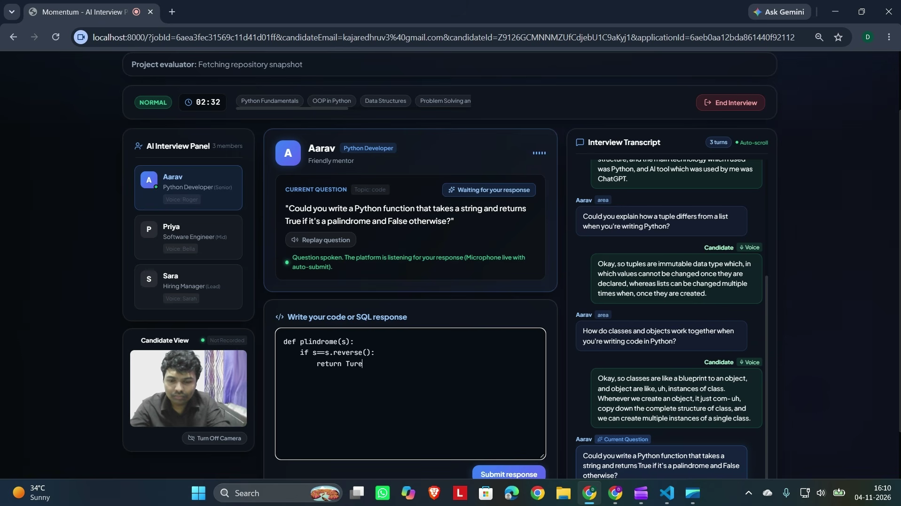
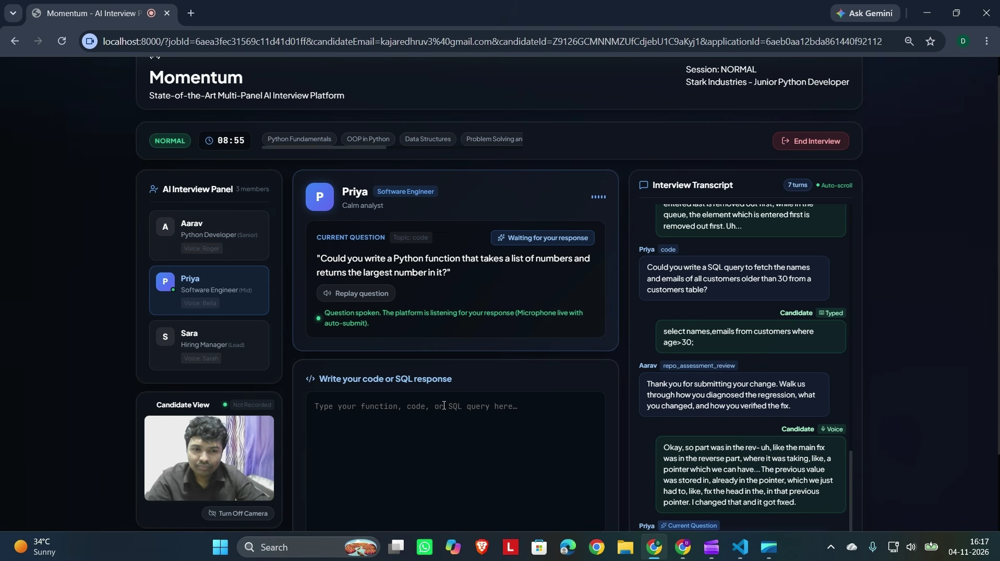
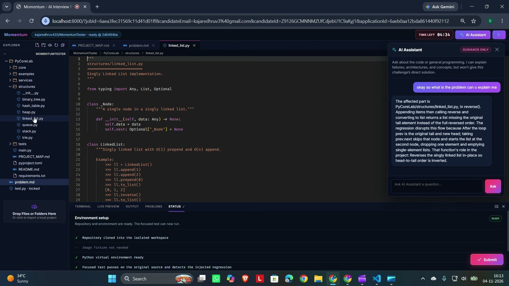
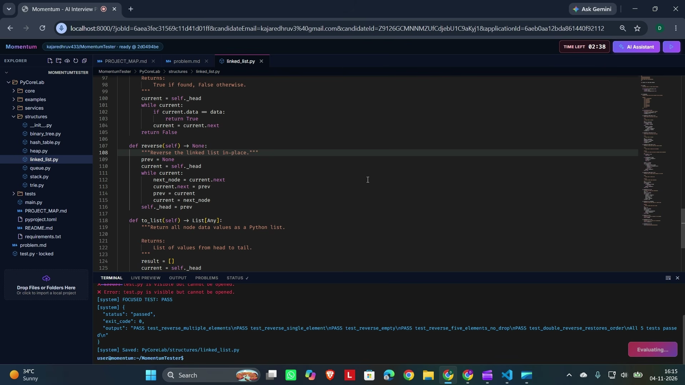
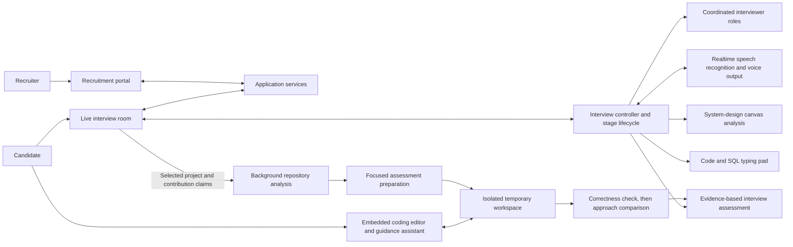

# Momentum

### An agentic interview platform that can examine the work behind a candidate's claims

Momentum is a multi-role AI interviewing platform. A coordinated panel conducts a live, adaptive interview, evaluates system-design work on a canvas, and can assess a candidate's contribution to a project they select from GitHub. Version 3 adds in-interview coding questions and an isolated, repository-specific bug-fix challenge.

> **Full explanation video — 13 minutes:** [Watch the Momentum demonstration](https://www.youtube.com/watch?v=Vsutph-l0Jc&t=100s)

---

## What Momentum does

Most interviews evaluate candidates through conversation alone. Momentum combines conversational evidence with structured stages, diagrams, typed code responses, and—when a candidate chooses to connect a project repository—hands-on evidence from a focused change in that project.

The panel is **agentic**: a coordinating interviewer adapts the next move to the candidate's answers and the interview state. It can pursue a clarification, move between competency areas, ask for a system-design drawing, pose a short syntax or coding question, or open a prepared repository assessment when one is ready. Panel members have distinct roles and take turns; they are coordinated personas in one controlled interview, not independent agents running without shared state.

The experience is adaptive within a bounded structure. Three timed stages—**Normal, Extended, and Final**—provide a predictable interview window. A server-controlled lifecycle manages stage transitions and closure, while the interviewer adapts the questions within each stage. This avoids an open-ended conversation that can drift for hours. The system-design canvas is an optional tool within the interview, not an extra timed stage.

---

## Product evolution

| Release | What it established | Candidate experience |
|---|---|---|
| **Version 1 — Interview foundation** | Recruitment and interview foundations: candidate and recruiter workflows, resume-aware context, a live multi-role interview, and evidence-based evaluation. | A structured AI-led interview with role-aware questions and a post-interview assessment. |
| **Version 2 — Real-time adaptive interview** | A richer voice experience, coordinated interviewer turns, live transcription, interruption handling, and the system-design canvas with visual assessment. A controlled three-stage lifecycle gives the adaptive interview a clear time boundary. | Candidates speak naturally, draw a system design when invited, and receive follow-ups shaped by their answers. |
| **Version 3 — Project-grounded technical assessment** | Adds GitHub repository selection, background repository analysis, an interview typing pad, and a targeted coding challenge in an isolated Daytona workspace. Adds correctness-first evaluation and a context-aware assistant restricted to explanation and conceptual guidance. | Candidates can demonstrate syntax and code skills, then explain and repair a focused regression in a project they discussed. |

Version 3 builds on the Version 2 interview and canvas. The coding assessment is an additional route within the interview, prepared in the background and offered when ready; it does not replace the conversation or canvas.

For the release summary, see [Release History](docs/release-history.md). For how the interview and repository assessment fit together, see [System Architecture](docs/architecture.md).

---

## The Version 3 interview, end to end

1. **Choose a project.** The candidate connects GitHub and selects a repository mentioned in their resume or interview. The original repository is read as the source for assessment; candidate edits happen in a temporary workspace.
2. **Discuss the contribution.** The panel asks about the candidate's role, work, technology choices, and the parts they built. The interview proceeds normally while repository analysis and challenge preparation happen in the background.
3. **Continue the adaptive interview.** The interviewer can ask follow-ups, probe system design on the canvas, or ask a focused syntax question. When a question calls for code or SQL, the typing pad appears in the interview so the candidate can write and submit a response.
4. **Open the repository challenge when ready.** The assessment targets a relevant area of the selected project and presents the candidate with a problem description in an embedded code editor. A small regression is introduced in an isolated Daytona workspace. The original GitHub repository is not modified.
5. **Use optional guidance and validation.** A repository-aware assistant can explain the affected code, behavior, and concepts, but is designed not to provide the completed fix. When the selected code can be tested in a manageable isolated environment, a Run action executes a focused test. The test file is locked from candidate viewing and editing. If that code cannot reasonably be run without reproducing heavyweight or unrelated project infrastructure, the assessment can proceed without dependency installation or a Run action.
6. **Evaluate in two steps.** First, the submitted change is checked for correctness against the original behavior. Only a correct solution proceeds to a comparison of its approach with the original implementation. The result adds evidence about project understanding and coding ability to the interview assessment.
7. **Return to the interview.** After submission, the panel resumes the interview flow and can continue probing other areas before the final evaluation.

This approach makes project claims testable while keeping the challenge scoped to a code area the candidate says they worked on. It is designed to reward demonstrated understanding, not repository size or framework setup.

---

## Version 2 — Interview and canvas

These screens show the interview experience that Version 3 extends: coordinated panel turns, a live transcript, and the system-design canvas.

*A role-specific interviewer asks a follow-up while the panel and transcript remain visible.*

*Candidates can sketch an architecture when the interview calls for a visual design response.*

---

## Version 3 — New capabilities

### Repository selection and interview typing pad

*Candidates select the project they want to discuss and potentially assess.*

*A coding or syntax question opens a typing pad within the interview.*

*The pad supports short code and SQL responses as part of the normal interview turn.*

### Isolated repository coding round

*The editor shows the affected project code, a problem description, and an assistant that provides explanations rather than the fix.*

*Where a focused local test is feasible, candidates can run it. The test file is locked and cannot be opened or edited.*

---

## High-level architecture

The interview controller owns the stage lifecycle and coordinates candidate context, panel actions, and interview tools. Repository analysis runs alongside the conversation. A challenge is prepared against a selected project snapshot and executed in an isolated workspace; candidate changes are evaluated there and are not pushed to the candidate's GitHub repository. The hidden focused test is available to the runner, not to the candidate through the editor.

---

## Public showcase scope

This repository is the public-facing product and architecture showcase. It describes system behavior, interfaces, and design decisions without publishing the private implementation of interview orchestration, assessment generation, repository analysis, or evaluation. The examples and diagrams here are explanatory and are not production source code.

## Documentation

- [System Architecture](docs/architecture.md)
- [Interview Flow](docs/interview-flow.md)
- [Release History](docs/release-history.md)
- [Product Demonstration Video](demo/demo-video.md)
- [API Showcase](api/README.md)
- [Security Policy](SECURITY.md)

## Author

**Dhruv Kajare**

- GitHub: [kajaredhruv433](https://github.com/kajaredhruv433)
- LinkedIn: [Dhruv Kajare](https://www.linkedin.com/in/dhruv-kajare-b060b0260/)
