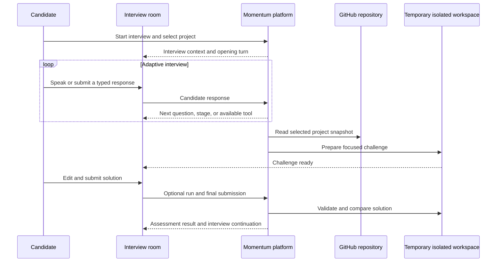

# Momentum Platform Interfaces

This page describes the public capability boundaries in Momentum. It is not a deployable API specification: production service URLs, authentication details, internal routes, schemas, and implementation code are intentionally not published in this showcase.

## Capability areas

| Area | Responsibility |
|---|---|
| **Recruitment portal** | Supports candidate and recruiter workflows, including roles, applications, and interview setup. |
| **Interview session** | Creates and advances an interview, coordinates panel turns and stage transitions, and records candidate responses. |
| **Realtime communication** | Carries interview events and speech interaction between the interview room and the platform. |
| **Interview tools** | Accepts canvas responses, typed code/SQL responses, and—when ready—entry into the repository coding round. |
| **GitHub project intake** | Connects a candidate-selected repository to the interview and supplies read-only project context for assessment preparation. |
| **Repository assessment** | Manages challenge readiness, isolated editing, optional focused test execution, submission, and result delivery. |
| **Evaluation** | Combines available interview evidence into a reviewer-facing assessment. |

## High-level interaction

## Security and data boundaries

- Candidate repository selection is used for assessment context; the assessment operates on a temporary isolated copy.
- Candidate changes are not pushed to the original GitHub repository.
- A generated focused test is locked from candidate-facing read and edit operations.
- Model-provider credentials and private assessment logic remain server-side and are not included in this repository.

For product behavior, read [Interview Flow](../docs/interview-flow.md). For architecture and assessment paths, read [System Architecture](../docs/architecture.md).
