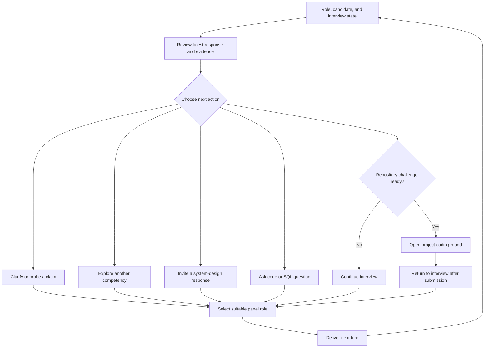

# Agentic Interview Workflow

Momentum uses an interview controller to coordinate role-specific interviewer personas, candidate context, tools, and session timing. The panel is adaptive because it can choose a different next action based on the candidate's response and what the interview still needs to assess.

## Decision cycle

The system does not treat each persona as a separate independent service. The roles contribute different evaluation perspectives while sharing a coordinated interview state and bounded stage lifecycle.

## What makes the interview agentic

- It can ask a targeted follow-up when an answer is vague, unsupported, or incomplete.
- It can choose an uncovered competency or project claim rather than follow a fixed question list.
- It can select the interviewer role best suited to the next question.
- It can use a canvas, typing pad, or repository assessment when that mode fits the evidence needed.
- It can continue through deeper timed stages or conclude according to the controlled interview lifecycle.

## Evidence across interview modes

The resulting assessment can combine spoken responses and transcript, typed code or SQL, canvas work, and repository challenge results when available. The repository assistant is designed for explanation and conceptual help; challenge completion remains the candidate's responsibility. A submitted repository fix is checked for correctness before the solution approach is compared with the original project reference.

See [Interview Flow](interview-flow.md) for the candidate journey and [System Architecture](architecture.md) for the high-level platform boundaries.
