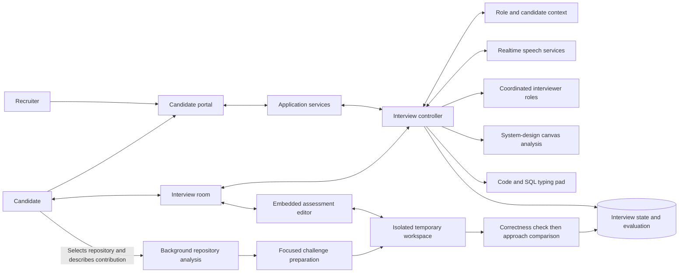
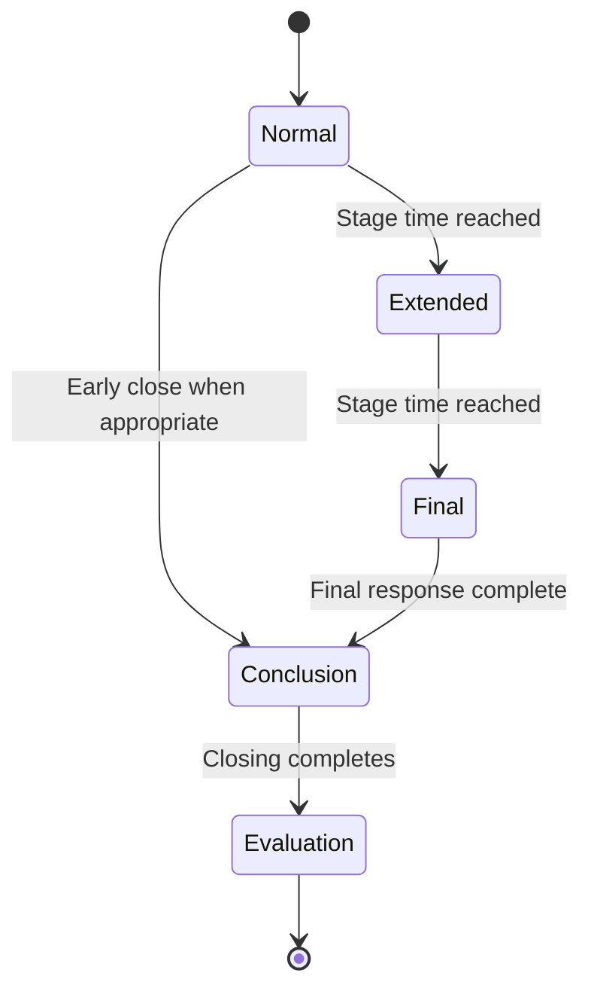

# Momentum System Architecture

This document describes the public product architecture across Versions 1–3. It focuses on responsibilities and information flow rather than private implementation details.

## System overview

Momentum combines a recruitment portal, a live interview room, a shared interview controller, and an optional repository assessment. The controller owns the interview lifecycle and coordinates panel decisions, voice services, candidate responses, and interview tools. Repository analysis is prepared separately while the interview continues.

The panel consists of distinct interviewer roles coordinated through one interview state and decision flow. It adapts questions and speakers based on the candidate's answers, role context, covered competencies, and available tools. This is an agentic interview experience with a controlled lifecycle, rather than an unbounded conversation.

## Full-stack application architecture

Momentum is composed of multiple cooperating application surfaces rather than a single chatbot page:

| Component | Implementation | Responsibility |
|---|---|---|
| **Recruitment portal** | Next.js, React, TypeScript | Candidate and recruiter flows, including jobs, applications, and interview setup. |
| **Interview room** | React, Vite | Voice interview UI, live transcript, interviewer panel, canvas, typing pad, and coding assessment. |
| **Application backend** | Python, FastAPI, Uvicorn | API boundary for product workflows, interview controller, state transitions, and realtime event coordination. |
| **Interview persistence** | MongoDB | Product and interview records used across candidate, recruiter, and interview experiences. |
| **Assessment lifecycle storage** | SQLite and MongoDB | Assessment lifecycle metadata and repository analysis context. |
| **Realtime speech** | WebSockets and ElevenLabs | Speech input and voice output integrated with the live interview flow. |
| **External execution and repository services** | GitHub and Daytona | Read the selected project and provide an isolated workspace for the coding round. |
| **Model services** | Meta Muse Spark through Meta Model API and Baseten | Interview reasoning, challenge preparation, and candidate-facing conceptual assistance. |

The frontends reflect different interaction needs: the portal handles standard hiring workflows, while the interview room maintains an active realtime session. The backend connects these surfaces to shared application state and external capabilities. This separation keeps product navigation, live interview interaction, model decisions, persistence, and remote execution as identifiable engineering concerns.

### End-to-end software workflow

1. Candidate and recruiter actions enter through the portal and are handled by application services.
2. Interview setup supplies candidate and role context to a new session.
3. The interview room communicates with the backend using request/response operations and realtime events.
4. The server records responses, advances the bounded interview lifecycle, and coordinates speech and model services.
5. If a repository assessment is selected, background preparation runs while the live interview continues.
6. When ready, the candidate edits in a temporary Daytona workspace; optional focused tests run there.
7. The backend returns the assessment result to the interview flow and incorporates available evidence into the final evaluation.

This involves ordinary software engineering concerns alongside AI: cross-frontend integration, API contracts, persistence, asynchronous work, realtime state, authentication and external services, error boundaries, and isolation of untrusted code execution.

## The bounded adaptive interview

The platform manages a timed sequence of Normal, Extended, and Final stages. The server-side lifecycle controls stage transitions and the session clock. Within each stage, the interviewer can choose among relevant follow-ups and assessment modes. A canvas prompt, a typing-pad question, or a repository challenge is a possible interview action, not a separate stage.

The fixed stage framework keeps the interview within a known variable time budget: a session can use the normal path or continue through deeper extended and final stages. The interviewer remains responsive to the candidate while the lifecycle prevents the session from expanding indefinitely.

## Repository challenge preparation

1. The candidate connects GitHub and selects a repository for discussion and possible assessment.
2. During the interview, the panel asks what the candidate built, their role, contribution, and technology choices.
3. After contribution context is available, repository analysis and challenge preparation run in the background while the interview continues.
4. The preparation process uses a pinned project snapshot to identify a relevant, bounded code area and prepare a problem description.
5. A challenge is staged in a temporary isolated workspace. The original repository is not modified, and candidate changes are not pushed upstream.
6. When the challenge is ready, the interviewer can open the coding round. The interview resumes after submission and evaluation.

The repository assessment tests a claim in context: the candidate must discuss their contribution and then reason about code in a project they selected. The challenge is intended to be scoped to a relevant change rather than require rebuilding the entire project.

## Conditional execution and locked tests

The assessment has two execution paths depending on whether the selected behavior can be tested practically in isolation:

| Assessment path | Workspace behavior | Candidate experience |
|---|---|---|
| **Runnable focused behavior** | Prepare only the dependencies needed for the focused test and run a hidden validation file in the isolated workspace. | A Run action is available. The test file is locked from candidate read and edit operations. |
| **Reference-based behavior** | Keep the challenge scoped to source analysis and reference comparison when running it would require heavyweight or unrelated infrastructure. | No dependency installation or Run action is required; the candidate still submits a code change for evaluation. |

In both paths, `problem.md` describes the affected behavior and what the candidate needs to investigate. It does not expose the intended patch or private evaluation reference.

## Candidate guidance and evaluation

The assistant has access to relevant repository context to explain code structure, behavior, and programming concepts. Its intended role is guidance: it can help the candidate understand the problem without giving the completed challenge solution.

Evaluation follows two steps:

1. **Correctness:** Determine whether the submitted change restores the intended behavior against the original project reference.
2. **Approach:** If correct, compare the candidate's solution approach with the original implementation and assess its quality relative to that reference.

This separates “did the fix work?” from “how does the fix compare to the project's original approach?” An incorrect change does not receive a positive approach comparison simply because it resembles part of the reference.

## Interview tools

### System-design canvas

The canvas lets candidates draw architecture and explain their design visually. The platform can assess the drawing alongside the spoken or typed explanation. It complements the verbal interview and remains available as an adaptive prompt within the staged session.

### Interview typing pad

The interviewer can ask a short code or SQL question during the normal interview. The room presents a typing pad when the question requires a typed response. The answer returns to the same interview flow and contributes evidence about syntax and coding fundamentals.

### Repository coding editor

The coding editor is a separate interview tool for the selected-project challenge. It is backed by an isolated temporary workspace with candidate-editable project files, a problem description, and—when available—a Run action. A generated focused test is not exposed through candidate-facing file operations.

## Privacy and public repository boundaries

GitHub access is used to read the candidate-selected repository for the assessment. Candidate edits take place in a temporary workspace, not in the upstream repository. Assessment workspaces are temporary and are removed after submission or expiry according to the service lifecycle.

This public repository intentionally explains behavior and boundaries without publishing private source, challenge-generation prompts, evaluation internals, credentials, or operational configuration. See [Security Policy](../SECURITY.md) for the public disclosure process.
