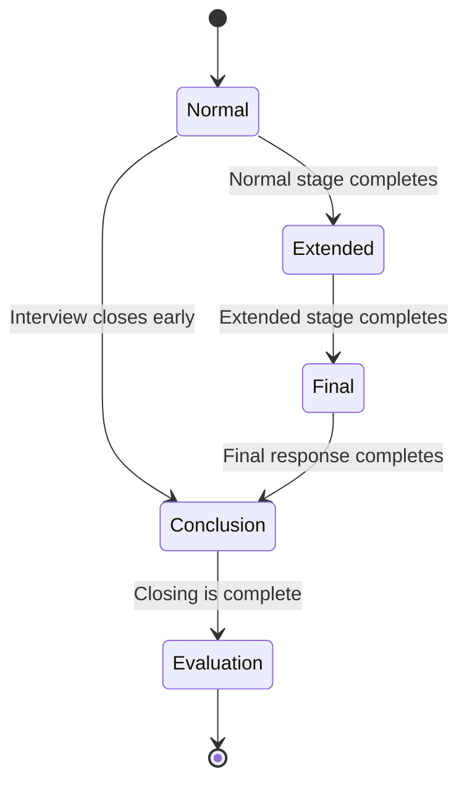
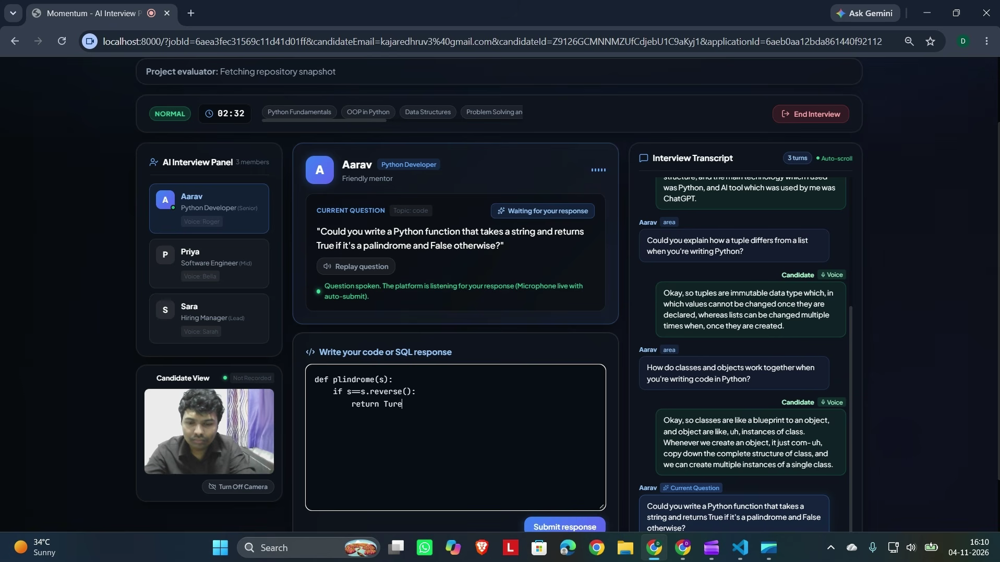
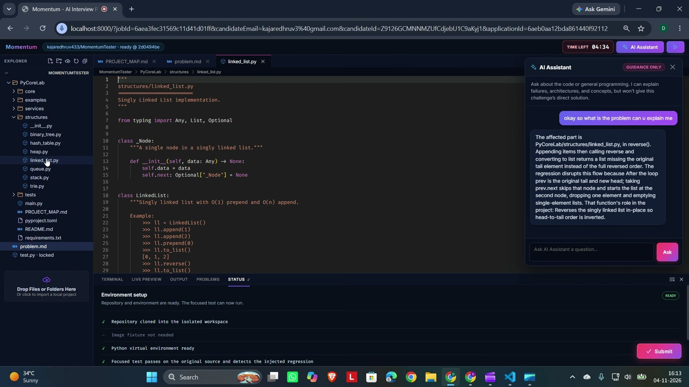

# Momentum Interview Flow

Momentum pairs an adaptive interviewer with a predictable session structure. The panel responds to candidate answers, while the interview controller keeps the session within three timed stages: Normal, Extended, and Final.

## The three-stage lifecycle

The server controls the stage clock and transitions. Exact session length can vary with the configured interview plan: a session may finish after the normal stage or continue through extended and final rounds. This gives candidates a defined time boundary while leaving the question path adaptive.

## What happens inside a stage

1. A panel member asks a role-appropriate question based on the candidate context and areas that still need evidence.
2. The candidate responds by voice; speech is transcribed for the interview record. The candidate may also submit typed answers when appropriate.
3. The controller considers the answer and current interview state, then chooses a follow-up, a new area, another interviewer, an available tool, or a transition.
4. The interview room displays the next turn, transcript, and any relevant response tool.

The panel's roles provide different perspectives, such as technical depth, project ownership, communication, or product judgment. They share the session context and are coordinated through the same interview flow.

## Optional assessment modes

### System-design canvas

When a question calls for architecture, the candidate can draw a design on the canvas and explain the decisions. The visual response becomes part of the assessment evidence. The canvas is an optional action within the interview, not a separate stage.

### Typing pad

When a question asks for code, syntax, or SQL, the typing pad appears in the interview room. The candidate submits a concise written response and the panel can continue the interview using it as evidence.

### GitHub project challenge

Candidates can select a project repository and discuss their own contribution while the panel continues its questions. Repository analysis and challenge preparation happen in the background. When ready, the interview can open a focused coding round in a temporary isolated workspace. The candidate investigates a described regression, may ask the assistant for conceptual guidance, and can run a focused test if the selected code can be executed practically. The test file is locked from the candidate.

The submission is first evaluated for correctness against original project behavior. A correct solution is then compared with the reference approach. After the coding round, the candidate returns to the ongoing interview.

## Closing and evaluation

At the end of the interview, the platform completes the closing turn and compiles an evaluation from the session evidence. This can include the transcript, typed responses, canvas work, and repository assessment results when available. The assessment is intended to give reviewers concrete evidence across communication, technical understanding, problem solving, and project contribution.

## Interview room screenshots

*The Version 2 room shows the interviewer panel, current question, candidate controls, and live transcript.*

*The system-design canvas adds a visual response mode to the interview.*

*The typing pad appears for a code response within the interview flow.*

*The repository challenge combines project code, a problem description, and contextual guidance.*
